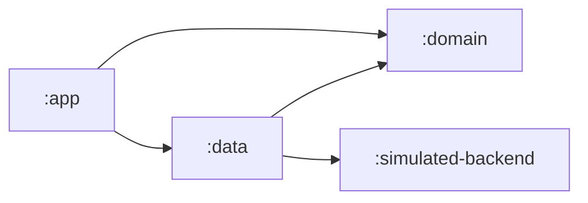
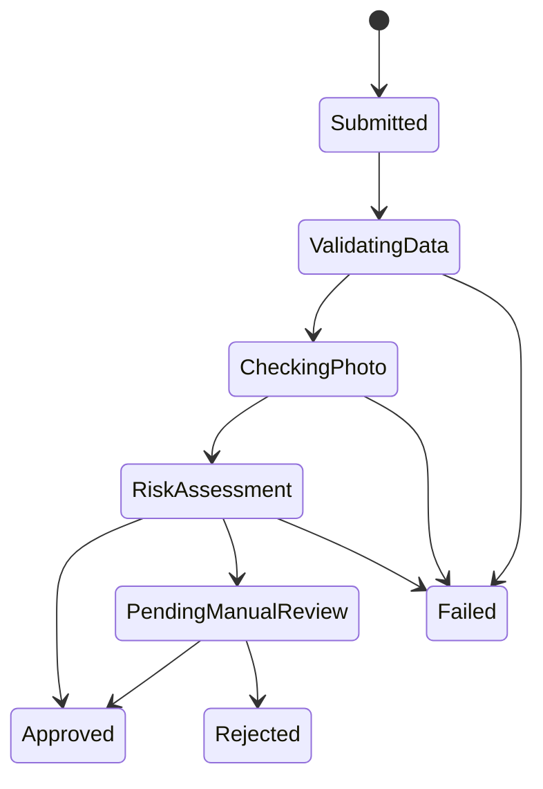

# Driving Licence Wallet

An offline-first Android app for the Scytales technical assignment. A citizen
fills in their details, picks a face photo and submits an application for a
driving licence. The app saves the application on the device at once, even
without a network, and processes it in the background through a simulated
issuer: data validation, a photo check and a risk assessment. The status
screen updates by itself and shows the full history, and a simulated reviewer
approves or rejects the applications that need a manual review.

The [Architecture Decision Record](docs/ADR.md) explains the three most
important decisions and their trade-offs. The [notes](docs/NOTES.md) list the
assumptions, the shortcuts, how AI was used, what to improve for production,
and what was deliberately left out.

## Run it

- Android Studio Rabbit 2 (2026.2.2) or newer, which Android Gradle Plugin 9.5
  needs.
- A phone or emulator with Android 10 (API 29) or newer.
- Gradle runs on JDK 25, as `gradle/gradle-daemon-jvm.properties` requires,
  and downloads it if the machine has none. From a terminal, `./gradlew` needs
  a JDK 17 or newer to start.

Open the project in Android Studio and run the `app` configuration. No server
or account is needed, because everything runs on the device. From a terminal:

```shell
./gradlew assembleDebug              # app/build/outputs/apk/debug/app-debug.apk
./gradlew test                       # JVM tests, no device needed
./gradlew connectedDebugAndroidTest  # device tests, with a phone connected
./gradlew build detektMain           # build, lint, tests and detekt, as in CI
```

The project uses Kotlin 2.4.21, Android Gradle Plugin 9.5.1, Gradle 9.9.0 and
SDK 37, with the newest library versions available when it was written
(`gradle/libs.versions.toml`). Two are pre-releases: Material 3 1.5.0-rc01,
whose date picker works with `LocalDate`, and detekt 2.0.0-alpha.6, which only
the build uses.

## Try it

Fill in the form, choose a JPEG photo and tap Submit. The assignment's example
data works, with a large enough photo. The status screen opens at once, with
the application's ID and status, and each processing step takes about 2
seconds. The outcome depends on the inputs:

| Outcome | Inputs |
|---|---|
| Approved automatically | Age 21 or older, category B, a national ID that is not on the watchlist, and a JPEG of at least 20 KB whose shorter side is at least 840 px |
| Pending manual review | Age 18 to 20, a category other than B, the national ID `XX000000` (the only ID on the simulated watchlist), or a photo whose shorter side is 480 to 839 px |
| Failed | Age under 18, a photo under 20 KB, or a photo whose shorter side is under 480 px |

The form already blocks missing fields, a malformed email and a missing photo,
and the picker shows only JPEG photos. The issuer checks all of them again, as
a server must, and its tests cover those failures.

The Simulation section on the status screen stands in for the issuer's back
office:

- **Approve** and **Reject** (with a reason) decide an application that is
  Pending manual review. For any other status, a message says why the decision
  was refused.
- **Server unreachable** makes every call to the issuer fail, like a dropped
  connection. Processing retries after about 10, 20, 40 and 80 seconds, then
  gives up on the 5th attempt with "The server could not be reached after 5
  attempts". Turning the switch off before then lets the next attempt continue.

To see the offline-first behaviour, turn on airplane mode and submit. The
application is saved and stays Submitted. Once the phone is online again,
processing runs, even with the app closed.

The app opens on the latest application, or on the form when there is none.
A finished application offers **New application**.

## Architecture



| Module | Contents |
|---|---|
| `:domain` | Pure Kotlin: the workflow, the application, the use cases, and the interfaces that `:data` implements |
| `:simulated-backend` | Pure Kotlin: the issuer's rules, settings and delays, called like a remote API |
| `:data` | Room with SQLCipher, the encrypted photos, the WorkManager worker, and the client that maps the issuer's codes to the domain's types |
| `:app` | Compose screens with Material 3, one ViewModel per screen (MVVM), Navigation 3, and the Hilt setup |

`:domain` has no Android code and no DI annotations, because Hilt modules in
`:app` and `:data` create the use cases.

**Where the rules live.** The app checks only what it can check offline: the
required fields, the email's shape and a JPEG photo (`ApplicationForm.kt`).
This gives instant feedback, and Submit accepts only the checked
`ApplicantDetails`. The issuer decides the business rules of the assignment's
section 5 (`SimulatedIssuer`), for four reasons: a server must not trust the
client, a watchlist shipped in the app could be read from it, rules change
without an app release, and ages depend on the processing date. The issuer
checks the required fields, the email and the photo type again, on purpose.

## The workflow



Each status is a type that offers only its allowed moves
(`ApplicationStatus.kt`). `CheckingPhoto` has no `approve()`, and the final
statuses (Approved, Rejected and Failed) have no moves, so an illegal move
does not compile. A move returns a `StatusChange`, whose constructor is
internal to `:domain`: other modules can save a change but cannot make one up.
Each event carries typed reasons (`WorkflowEvent.kt`), which only the UI turns
into text. The data and photo checks go to Failed when they fail, and any
processing step goes to Failed when processing gives up after repeated
network errors.

The status is never stored. `LicenceApplication` reads its status, `createdAt`
and `updatedAt` from its history, and `record()` accepts only a change that
starts from the current status. Reading an application back replays its saved
events through the same moves (`LicenceApplication.restore`), so a damaged
history never reaches the app.

The usual alternative, an enum with a transition table, checks the moves only
at runtime; the [ADR](docs/ADR.md) compares the two. Tests:
`ApplicationStatusTest` and `LicenceApplicationTest`.

## C1: atomic transitions

Only the history is stored, so a status cannot disagree with it. The
`applications` table holds the applicant's details and has no status column.
The `history` table holds one row per event, so a status change is one insert.

`RoomLicenceApplicationRepository.record` runs in one write transaction. It
reads the application, checks that the change starts from the current status,
and inserts the new row. Readers, including the status screen's Room `Flow`,
load an application with its history in one transaction. So every observer,
including the app after a crash, sees a change completely or not at all.

What would break it:

- a stored copy of the status, such as a status column written in a separate
  statement;
- reading the status outside the write transaction, so that two runs could
  both add the same move;
- writing history rows without the status check of `record`, or deleting them;
- reading an application and its history in separate transactions.

Tests, on a device, against the real encrypted database
(`RoomLicenceApplicationRepositoryTest`):

- `givenAnObserver_whenAMoveIsRecorded_thenItGetsTheApplicationWithTheNewStatusAndEntry`
- `givenTenRunsRecordingTheSameMoveAtOnce_whenTheyFinish_thenExactlyOneIsRecorded`
- `givenASubmittedApplication_whenAMoveFromAnotherStatusIsRecorded_thenItIsRefusedAndNothingIsSaved`

## C2: crash-safe, idempotent processing

`ProcessApplicationUseCase` runs the steps one at a time, and saves each
step's result before it calls the issuer for the next one. Every run starts
from the saved status, so a saved step never runs again. A rerun is safe,
because:

- the issuer's answers depend only on the request, and the age checks use the
  time processing started, which is saved once in the history, so a repeated
  call gets the same answer, even on a later day;
- the issuer's checks only read, so repeating the one unsaved call has no side
  effect;
- `record` refuses a change that another run saved first, and the run then
  continues from the stored status.

Failures are of three kinds:

- **Temporary:** the issuer cannot be reached. `SimulatedIssuerClient` turns
  an `IOException`, and nothing else, into `BackendResult.Unavailable`, and
  WorkManager retries the run with backoff. On the 5th attempt, the
  application goes to Failed, with `ProcessingAbandoned` in its history.
- **Permanent:** the issuer's answer, such as an applicant under 18 or a photo
  that is too small. The application goes to Failed, with the problems.
- **A bug:** any other exception. The worker logs its type and ends the work
  with `failure()`, because a retry would fail the same way. The application
  keeps its status, and the next app start schedules it again.

If the process dies:

| After... | Then |
|---|---|
| Submit stored the photo, but before it saved the application | Nothing refers to the photo, and the next app start deletes it |
| Submit saved the application, but before it scheduled processing | The next app start schedules it (`ResumeProcessingUseCase`) |
| an issuer call, but before its result was saved | The status has not moved, so the same call runs again and gets the same answer |
| a result was saved | The run continues from the new status, and the saved step does not run again |
| the last result was saved, but before the work finished | The rerun finds the final status, or Pending manual review, and stops |

WorkManager runs interrupted work again by itself, and each save is one
transaction, so it is either complete or absent.

Tests, on the JVM (`ProcessApplicationUseCaseTest`). A fake repository crashes
right before or right after each save, then processing runs again:

- `given a crash right after any step is saved, when processing runs again, then the history is the same as without a crash and no step runs twice`
- `given a crash right before any step is saved, when processing runs again, then the history is the same as without a crash and only the unsaved step runs twice`
- `given another run saves a step first, when this run tries to save it, then it carries on and the history has each step once`
- `given processing started before a crash, when it runs again on a later day, then the backend still gets the time processing started`

On a device, `ProcessingWorkTest` runs the real worker: the 5th failed attempt
fails the application, and a bug fails the work but keeps the status.

## C3: a deterministic, framework-free domain

- The workflow, the rules and the processing engine live in `:domain` and
  `:simulated-backend`, Kotlin/JVM modules without Android on their classpath,
  so the compiler keeps them free of the framework. Their 60 tests run on the
  JVM, without Robolectric or an emulator.
- Time is a dependency. Submit, Review and the engine take a
  `kotlin.time.Clock`, which the tests fix, and the issuer gets the processing
  time with each request instead of reading a clock.
- The issuer's delay is a setting (`IssuerConfig.responseDelay`), and its tests
  run on virtual time, so they never sleep (`SimulatedIssuerTest`).
- The types do the enforcing: the statuses and their moves, `ApplicantDetails`,
  which holds only checked values, and `RejectionReason`, which cannot be
  blank.

## Offline and background processing

Submit (`SubmitApplicationUseCase`) needs no network. It stores the photo,
saves the application with its first history entry, and schedules processing,
in that order. It runs in the application's scope, so leaving the screen does
not stop it halfway.

Room is the queue: the encrypted database keeps the application, and
`WorkManagerProcessingScheduler` enqueues one unique work per application
(`ExistingWorkPolicy.KEEP`), which waits for a network and retries with
exponential backoff from 10 seconds. The work's only input is the
application's ID, because WorkManager's own database is not encrypted. At each
app start, `ResumeProcessingUseCase` schedules an unfinished application
again, which does nothing while its work is queued, and `PhotoCleanUp`
deletes the photos that no application uses.

The status screen observes the database. `LicenceApplicationRepository.observe`
is a Room `Flow` that emits after every committed change, from the worker or
the reviewer. `LicenceApplicationViewModel` turns it into a `StateFlow` with
`stateIn` (`WhileSubscribed`, 5 seconds), and the screen collects it with
`collectAsStateWithLifecycle`. Test: `LicenceApplicationViewModelTest`.

## Business rules and the processing date

The issuer applies the assignment's rules (`SimulatedIssuer`), with its
settings in `IssuerConfig`: the watchlist, the minimum photo size and the two
quality thresholds. The photo's quality score is simulated from its
resolution, read from the JPEG header: 100 when the shorter side is 1200 px
or more, and proportionally less below that.

Ages are measured on the date processing started. In the EU, minimum ages
apply when the licence is issued (Directive 2006/126/EC), and the start of
processing is the closest date that the app knows. That time is the
`ProcessingStarted` history entry, saved once, so a rerun on a later day
checks the same age. The date is the issuer's local date (`Europe/Brussels` by
default), not the phone's. Someone born on 29 February turns a year older on
1 March in other years. The assignment's ages, 18 and 21, apply to every
category; the directive's ages per category are left out.

Tests: `DataCheckTest`, `PhotoCheckTest` and `RiskAssessmentTest`.

## Data protection

- **The database** (the details and the history) is encrypted with SQLCipher.
  Its key is 32 random bytes, which SQLCipher uses directly, without a slow
  key derivation (`EncryptedDriver`).
- **The database key** is saved in `no_backup/database.key`, encrypted with
  AES-256-GCM by a key in the Android Keystore, through Tink (`DatabaseKey`).
  The Keystore key cannot leave the phone, so a copy of the app's files cannot
  be decrypted.
- **The photo** is encrypted with Tink's streaming AEAD while it is copied
  from the picker, so no plain copy is ever written (`EncryptedPhotoStorage`).
  Its key is encrypted by a second Keystore key (`PhotoKey`). The photo stays
  in app-private storage (`no_backup/photos`), with its reference in Room,
  because processing must work offline. Jetpack Security's `EncryptedFile`,
  the assignment's example, is deprecated, and it wrapped the same Tink
  primitive.
- **Backup and device-to-device transfer** are off: `allowBackup="false"`, and
  both rule files exclude all data.
- **WorkManager's database** is not encrypted, so it holds only the
  application's ID.
- **Logs** (Timber) carry only IDs, attempt numbers, results, counts and error
  types, never an error's message, and release builds plant no Timber tree.

Tests, on a device: `EncryptedDatabaseTest` (the files hold no SQLite header
and no national ID, and another key cannot read them),
`EncryptedPhotoStorageTest` (no JPEG header and no photo bytes) and
`DatabaseKeyTest`.

Limitations:

- The keys need no user authentication, so anyone who can unlock the phone
  can open the app and see the data. A rooted phone, or malware with the app's
  privileges, can use the keys while the app runs.
- The recent-apps thumbnail can show the form, including the national ID.
  `setRecentsScreenshotEnabled(false)` would hide it on Android 13 and newer.
- The applicant sees internal review reasons, such as "The national ID is on
  the watchlist". A real issuer would show them only to its reviewers.
- A lost Keystore key makes the data it protects unreadable, as described
  next.

### When the database cannot be opened

If the database key cannot be decrypted, the app crashes at every launch with
an `IllegalStateException` from `DatabaseKey`, until the user clears its
storage in Settings, which deletes every application. It is rare, but it can
happen:

- The Keystore loses the key or cannot use it. Tink's documentation says that
  "Android Keystore is unreliable on certain devices", and that a missing key
  "is an irrecoverable error".
- The key file or the database is damaged.
- The Keystore is busy. Tink calls this unlikely without many parallel calls,
  and the app makes one call each time the database opens.
- A future bug, such as a missing migration, fails in the same place.

Lock-screen changes do not cause it, because the key needs no user
authentication. A move to a new phone does not either, because backup and
transfer exclude all data.

The app never deletes data by itself: the phone holds the only copy, and a
temporary failure must not wipe it. `DatabaseKey` makes a new key only while
no database exists. A production app would show a recovery screen instead of
crashing, report the error, and offer a reset that downloads the applications
again from the server. The photo key follows the same rule: if it is lost
while photos exist, those photos cannot be read, and no new photo can be
stored until the app's data is cleared.

To reproduce it on the debug build (`run-as` needs a debuggable app):

```shell
adb shell am force-stop gts.drivinglicencewallet
adb shell run-as gts.drivinglicencewallet cp no_backup/database.key no_backup/database.key.original
adb shell "run-as gts.drivinglicencewallet sh -c 'echo broken > /data/data/gts.drivinglicencewallet/no_backup/database.key'"
# Open the app: it crashes at every launch. Then restore the key:
adb shell run-as gts.drivinglicencewallet cp no_backup/database.key.original no_backup/database.key
adb shell run-as gts.drivinglicencewallet rm no_backup/database.key.original
```

Do not name the copy `database.key.bak`, because `AtomicFile` treats that name
as its own backup and restores it on the next read. Tests:
`DatabaseKeyTest.givenADatabaseAndAKeyThatCantBeDecrypted_whenTheKeyIsRead_thenItFailsAndNothingIsDeleted`
deletes the real Keystore key, and `EncryptedPhotoStorageTest` covers the
photo key in the same way.

## Reliability

The assignment's questions, in its order.

**Two workers race on the same application.** Each application has one unique
work with `KEEP`, so a second enqueue does nothing while the first is queued
or running. If two runs still overlap, for example a stopped worker that is
still finishing, `record` refuses the second run's change, and that run
continues from the stored status. Tests:
`givenTenRunsRecordingTheSameMoveAtOnce_whenTheyFinish_thenExactlyOneIsRecorded`,
`givenAnApplicationScheduledTwice_whenItsRunsAreListed_thenThereIsOneRunThatWaitsForTheNetwork`,
and the racing run in `ProcessApplicationUseCaseTest`.

**Connectivity drops during the photo or the sync.** The photo comes from the
system Photo Picker and is copied into encrypted storage at Submit, without
the network. If the copy fails, for example for a cloud photo while offline,
nothing is stored, and the form asks for another photo
(`givenAPhotoThatCantBeRead_whenItIsStored_thenNothingIsStored`). Processing
waits for a network. A call that fails midway is `Unavailable`: nothing is
saved for that step, and WorkManager retries it with backoff (see C2).

**Invalid transitions.** The types prevent them, and so do `record`, which
checks the current status in the same transaction as the write, and the
replay on every read (see "The workflow" and C1).

**Failures shown versus retried silently.** Temporary issuer failures are
retried in the background and only logged, and the status stays as it is.
Giving up after 5 attempts and every failed check become Failed, with the
reason under the status and in the history. A refused review decision shows a
message, and so does a photo that cannot be read. A bug in a step is the gap:
the status stays as it is, with no sign on the screen, until the next app
start schedules the work again. The next step would be a banner on the status
screen from WorkManager's work info, such as "Waiting for the network" or
"Retrying".

**Idempotency key.** The application's ID is a random UUID that the app
creates before it stores anything (`ApplicationIdGenerator`). The photo file,
the unique work name and every retry use it. With a real server, the app would
send it with the submission, for example as an `Idempotency-Key` header, and
the server would answer a repeated request with the application it already
has.

**Retries and backoff.** The work retries with exponential backoff from 10
seconds, WorkManager's minimum, and only with a network. The domain decides
when to give up (`MAX_ATTEMPTS = 5` in `DataModules.kt`). A permanently failed
submission is Failed, with "The server could not be reached after 5 attempts"
on the screen and `ProcessingAbandoned(attempts = 5)` in the history. Failed is
final, and **New application** starts again. WorkManager also counts the runs
that the system stopped, so a run stopped several times gives up sooner.

**A field added in v2.** The schema is exported to `data/schemas/`. For a new
column that is nullable or has a default value:

1. add the property to `LicenceApplicationEntity`, with
   `@ColumnInfo(defaultValue = …)` if it is not nullable;
2. set `version = 2` and `autoMigrations = [AutoMigration(from = 1, to = 2)]`
   on `@Database`, and commit the new `2.json`;
3. test the migration from version 1 on a device, with Room's
   `MigrationTestHelper`.

A renamed or removed column needs an `AutoMigrationSpec` or a hand-written
`Migration`. Renaming an enum constant that the history stores, such as an
event or a reason, needs a data migration too. SQLCipher changes nothing here,
because migrations run inside the encrypted database.

**Before production:** see the [notes](docs/NOTES.md#before-production).

## Tests

| Module | Tests | What they cover |
|---|---|---|
| `:domain` | 45, JVM | The workflow, the form check, Submit, Review, resume, and processing with its crash tests |
| `:simulated-backend` | 15, JVM | The assignment's rules, the processing date, and the delay on virtual time |
| `:data` | 4, JVM | The issuer's codes, and an unreachable issuer as `Unavailable` |
| `:app` | 11, JVM | The two ViewModels, and the date picker's block on future dates |
| `:data` | 26, device | The encrypted database and the repository (C1), the keys, the photos, and the worker |

The tests use fakes instead of mocks, no Robolectric, and virtual time
(`runTest`). The device tests run against the real encrypted database and the
real Keystore.

# Short Demo

https://github.com/user-attachments/assets/6b923060-1f76-4f3f-9bf8-aa9d16deb1c1


